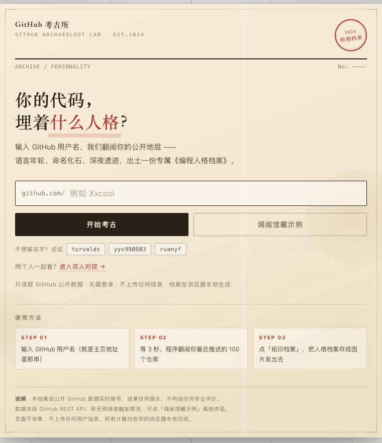
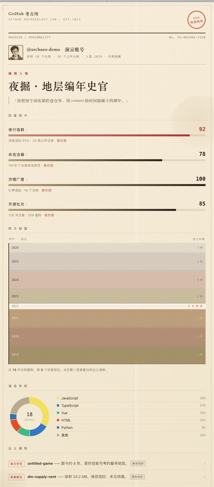
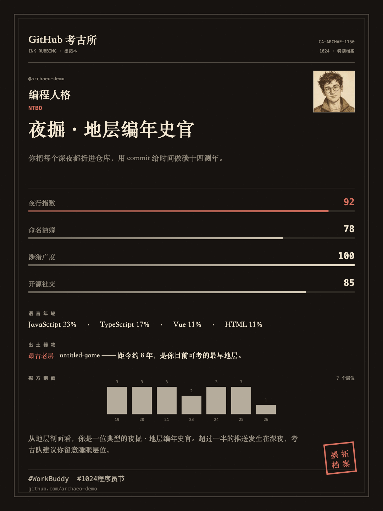
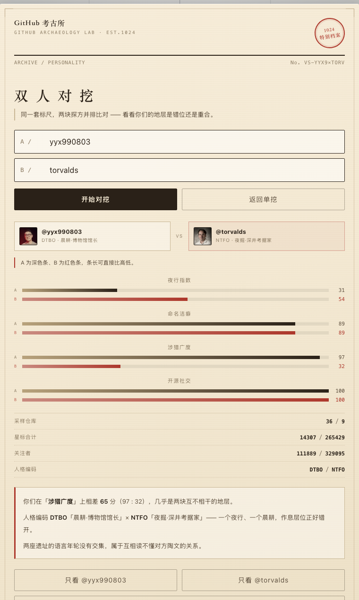

# GitHub 考古所 · 编程人格档案

> 输入一个 GitHub 用户名，翻阅你的公开地层，出土一份专属《编程人格档案》。

**在线体验 → [github-archaeology.app.workbuddy.host](https://github-archaeology.app.workbuddy.host/?sharecode=HVE7YZLNGQ)**

不用注册、不用强制登录，点开就能测，三秒出档案（亦支持自愿登录解锁 5,000 次/小时高配额）。没有 GitHub 账号也没关系，页内有示例档案可以看完整效果。



---

## 它挖了些什么

把你的 GitHub 仓库当成一处考古现场，从中出土四样东西：

### 语言年轮

按语言给有推送的仓库分类，画成环形图，占比精确合到 100%。示例账号 18 个仓库：JavaScript 33%、TypeScript 17%、Vue 11%、HTML 11%、Python 6%、其他 22%。偏科还是万金油，一眼看出来。



### 四维探方

| 维度 | 算法 | 示例值 |
| --- | --- | --- |
| 夜行指数 | 提交时间的小时分布，深夜占比越高分越高 | 92 |
| 命名洁癖 | 命名规范的仓库数 / 仓库总数 | 14/18 → 78 |
| 涉猎广度 | 语言种类数 + 仓库规模 | 9 种语言 / 18 个仓库 → 100 |
| 开源社交 | 关注者与 Star 的量级 | 128 关注 / 268 星 → 85 |

每一项旁边都标了计算依据，不是拍脑袋给分。点开任意一项，能看到这一项具体是怎么算的：夜行指数会画出 24 小时直方图（红色是 22:00–06:00 的深夜时段），命名洁癖会列出被判为随性的那些仓库名。

### 探方剖面

把仓库按创建年份码成一条地层柱：越早的层越深越暗，层厚正比于当年新增的仓库数。中间断了年份的，直接标一条「文化断层」。

示例账号从 2019 排到 2026，2022 那一年是空的，于是断层就出现在那儿。点任意一层，下方会列出当年出土的仓库清单。

### 出土器物

自动挖出四个"文物"：最古老的一层、最重的藏品、最亮的展品、命名化石。

示例账号挖出来的是：最早 8 年前的 `untitled-game`、24.2MB 的 `dm-supply-next`、86 星的 `juejin-csdn-extension`，还有那个一看就是凌晨三点随手敲的 `test`。

点开每件器物有状态判定：

| 状态 | 判定条件 |
| --- | --- |
| 已封存 | `archived` 为真，地层定格 |
| 外来传入 | `fork` 为真，从他处迁入 |
| 风化严重 | 最近一次推送超过 540 天 |
| 铭文缺失 | 没有 `description` |
| 保存完好 | 以上都不是 |

展开后还会列出语言、创建时间、最近堆积、体积、星标与 fork 数。

### 年度切片

按年份切开看：那一年新增了几个仓库、主语言是什么、拿了多少星、具体是哪几个仓库。和剖面对应着看，能看出某一年是不是突然开了一堆坑。

### 编程人格 + 判词

四维分数组合成 16 型里的一种，配一句判词。示例账号是「**夜掘·地层编年史官**」：

> 「你把每个深夜都折进仓库，用 commit 给时间做碳十四测年。」

最后可以一键导出 1080×1440 的档案卡，带印章和话题标签，存下来直接发朋友圈。

### 三套分享卡

同一份档案有三种排版：

- **档案纸** 1080×1440，米色纸面 + 双线边框 + 朱红印章
- **墨拓** 1080×1440，深底浅字，像从碑上拓下来的一张
- **标本签** 1080×1080，方形标签，四维分数排成 2×2



### 双人对挖

`?vs=用户名A,用户名B` 直接出对比页：两人的人格编码、四维数值上下对照，再给一段「你们差在哪」的判词。结果页可以复制对比链接。



### 纸张做旧

页面上叠了几层很轻的手工痕迹：右侧一处茶渍、一条竖向折痕、四周的暗角，还有结论下面那句歪着写、红色钢笔色的值班员批注。都是 CSS 渐变画的，不占一张图。

---

## 技术实现

**单文件 HTML + 原生 JS，零依赖零构建。** 整个应用就是一个 `index.html`，不引任何 CDN、不用打包工具、字体全走系统字体。改成什么重新发布都只是覆盖一个文件。

数据只取 GitHub 三个公开接口，`Promise.all` 并发：

```js
const base = "https://api.github.com";
const [pr, rr, er] = await Promise.all([
  fetch(`${base}/users/${username}`),
  fetch(`${base}/users/${username}/repos?per_page=100&sort=pushed`),
  // events 是可选数据源，失败不该拖垮整个流程
  fetch(`${base}/users/${username}/events/public?per_page=100`).catch(() => null)
]);
```

几个实现取舍：

- **`events` 单独 `catch` 降级**。`/events/public` 对某些账号返回空甚至失败，但它只影响「夜行指数」一项，不该让整个档案挂掉。
- **错误分级**。`404` 是用户不存在，`403/429` 是限流，提示语完全不同。
- **分享卡用 Canvas 2D 导出**。头像需 `crossOrigin="anonymous"`，否则画布被污染、`toBlob` 抛 `SecurityError`——而且 `drawImage` 阶段不报错，报错位置和真因隔了好几行，很容易查错方向。
- **百分比用最大余数法取整**。四舍五入会让 33+17+11+11+6+22 变成 101%，改成先取整、再把剩下的几个点按小数部分从大到小补回去。
- **深链**。`?u=用户名` 直达档案、`?vs=A,B` 直达对比、`?demo` 直达示例，方便分享，也方便自己测试。
- **离线兜底**。接口不可用时给出明确原因，并可切到内置示例档案，保证打开的人永远有东西看。

---

## 本地运行

```bash
git clone https://github.com/Xxcool/github-archaeology.git
cd github-archaeology
open index.html      # macOS
# 或者直接双击 index.html
```

不需要起服务，不需要装依赖。

---

## 隐私与权限说明

本项目坚持**「零侵入、纯前端、公开只读」**的设计原则：

1. **公开数据测绘**：默认匿名状态下，仅通过 GitHub REST API 调阅公开数据（`/users`、`/users/:name/repos`、`/users/:name/events/public`），每小时享有 60 次发掘频次。
2. **可选登录解锁高配额（5,000 次/h）**：
   - 登录授权**完全由用户自主按需触发**（默认无需登录即可直接发掘与调阅示例）。
   - 权限仅请求最严格的公开只读范围（`read:user`），**绝不索取任何私有仓库权限，更无代码读写、账号修改等任何敏感操作**。
3. **数据绝不上传**：
   - 授权产生的 Access Token **仅保存在访客本地浏览器的 `localStorage` 中**；
   - 考古所没有后端数据库，所有地层分析、人格推导、Canvas 档案卡生成**100% 运行在访客本地浏览器中**；
   - 绝不收集、不中转、不留存任何用户 Token 或个人私隐。关掉页面或随时点击「退出」，本地凭据即刻彻底销毁。
